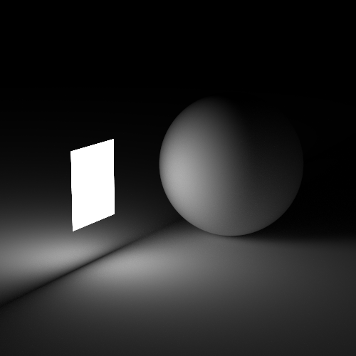
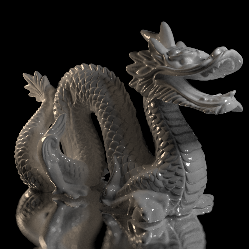
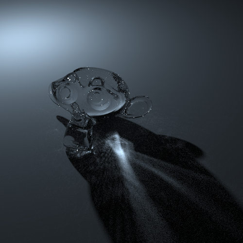
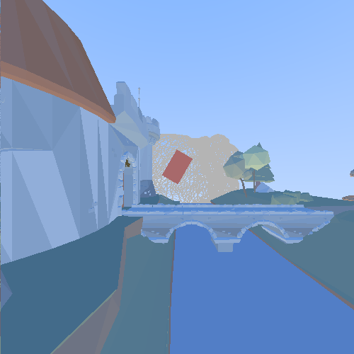
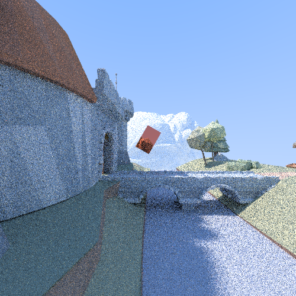
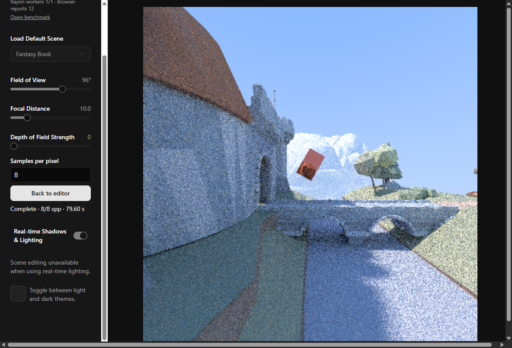
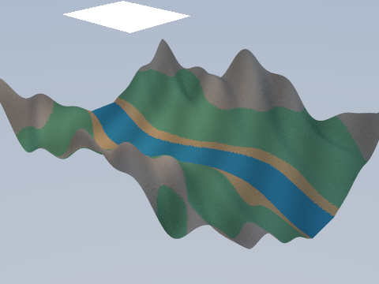

<div align="center">
  <h1>◈ 3D Graphics</h1>
  <p><strong>Edit and render 3D scenes directly in your browser.</strong></p>
  <p>Live raster previews · Progressive CPU path tracing · Reproducible BVH benchmarks</p>

  <p>
    <a href="wasm-graphics/Cargo.toml"></a>
    <a href="wasm-graphics/build.ps1"></a>
    <a href="benchmarks/README.md"></a>
    <a href="web/package.json"></a>
  </p>

  <p>
    <a href="#quick-start"><strong>Run locally</strong></a> ·
    <a href="#see-it-in-action"><strong>See the renderer</strong></a> ·
    <a href="#benchmark"><strong>Explore the benchmark</strong></a>
  </p>

  <table>
    <tr>
      <td width="33%"><a href="images/rt10.png"></a></td>
      <td width="34%"><a href="images/rt7.png"></a></td>
      <td width="33%"><a href="images/rt11.png"></a></td>
    </tr>
  </table>
  <sub>Gallery renders from the original 3D Graphics engine.</sub>
</div>

---

## Why 3D Graphics?

Move through a scene, change its geometry and materials, and watch the same camera view resolve into a path-traced image. Both renderers run on the CPU inside the browser through Rust and WebAssembly.

- **Build a scene.** Start with a preset, add spheres and boxes, or import a GLB model. Move, rotate, and scale objects in the editor.
- **Preview while editing.** Use the raster view to frame the camera and adjust the field of view, focal distance, and depth of field.
- **Trace the lighting.** Explore diffuse, metal, glass, emissive, and clear-coat materials. Set a samples-per-pixel target, follow progress, and cancel back to the editor.
- **Measure the engine.** Compare brute-force intersections with a bounding volume hierarchy (BVH), then measure what changes when Rayon uses eight workers.

## See it in action

### Fantasy Book scene

The same edited scene and camera in the raster preview and the finished 8-sample path trace. Select either image to open the full-size capture.

<div align="center">
  <table>
    <tr>
      <th width="50%">Raster preview</th>
      <th width="50%">Path tracing · 8 samples per pixel</th>
    </tr>
    <tr>
      <td><a href="benchmarks/results/editor/raster.png"></a></td>
      <td><a href="benchmarks/results/editor/path-traced.png"></a></td>
    </tr>
  </table>
</div>

<details>
<summary>View the scene editor and render controls</summary>

[](benchmarks/results/editor/editor.png)

</details>

### From scene to render

1. Load a preset or choose **Add New Object** to add a primitive or import a GLB.
2. Click the canvas to look around. Use **WASD** to move and **Esc** to release the pointer.
3. Select an object and open **Edit Selected Object** to adjust its transform or material.
4. Set **Samples per pixel** and select **Start render**. Return to the editor when the image is complete or cancel the current run to keep editing.

---

## Benchmark

<div align="center">
  <a href="benchmarks/results/preview/valley-preview.png"></a>
  <br>
  <sub>Valley · 100,000 triangles · 480 × 360 at 32 samples per pixel for this preview</sub>
</div>

The timed runs use the same camera, geometry, materials, seed, and quality settings across all three configurations. The table reports medians from five completed runs per configuration at **96 × 72, 2 samples per pixel, depth 5**, on an AMD Ryzen 5 5625U with Chrome 157 on Windows.

| Configuration | Rayon workers | Render compute | End to end |
| :--- | ---: | ---: | ---: |
| A · Brute force | 1 | 30,181.56 ms | 30,310.60 ms |
| B · Flattened BVH | 1 | 53.23 ms | 336.65 ms |
| C · Flattened BVH | 8 | 15.25 ms | 329.34 ms |

The linear RGB images matched exactly across all configurations. A → C was **92.03× faster end to end** for this fixture. B → C reduced render compute by **3.49×**, while BVH construction and startup accounted for most of the end-to-end time at two samples per pixel.

[Methodology and reproduction (Tiếng Việt)](benchmarks/README.md) · [100,000-triangle runs](benchmarks/results/full-final/runs.json) · [640-triangle runs](benchmarks/results/small-final/runs.json)

---

## Under the hood

| Component | Implementation |
| :--- | :--- |
| Rasterizer | Rust scanline triangles, depth buffer, perspective-correct interpolation, and shadow maps |
| Path tracer | Progressive CPU rendering with direct light sampling, multiple importance sampling, and a flattened BVH |
| Parallel runtime | Rayon workers in shared WebAssembly memory, with deterministic random streams per pixel and sample |
| Browser editor | React and TypeScript with a Canvas 2D display and Vite |

## Quick start

Use a Chromium browser and run these commands from the repository root on Windows. Install Node.js and npm, Rust nightly `nightly-2024-08-02` with `rust-src` and `wasm32-unknown-unknown`, and `wasm-bindgen` CLI **0.2.100**. [Windows toolchain setup](benchmarks/README.md#build-từ-source)

```powershell
.\wasm-graphics\build.ps1
Set-Location web
npm.cmd ci --no-audit --no-fund
npm.cmd run build -- --outDir ../wasm-graphics/target/web-interactive
npm.cmd exec -- vite preview --host 127.0.0.1 --outDir ../wasm-graphics/target/web-interactive
```

Open the localhost URL printed by Vite. Select **Open benchmark** in the editor to try configurations A, B, and C. The threaded renderer requires cross-origin isolation and `SharedArrayBuffer`. Vite serves the required headers in dev and preview.

## Credits

The original engine, editor, and gallery are from [ElliottF05/3D-Graphics](https://github.com/ElliottF05/3D-Graphics). This version adds the controlled benchmark, deterministic sampling, and render progress and cancellation. The original project cites [Ray Tracing in One Weekend](https://raytracing.github.io/books/RayTracingInOneWeekend.html) as an inspiration.

[Repository About copy and topics](ABOUT.md)
